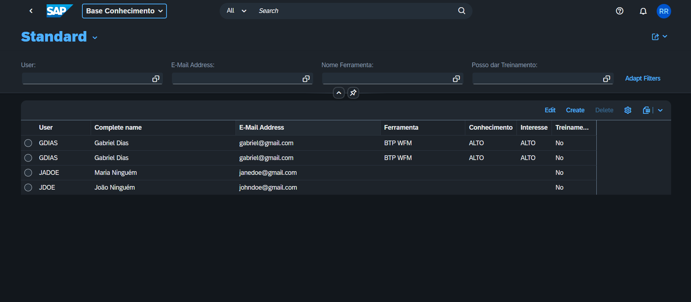
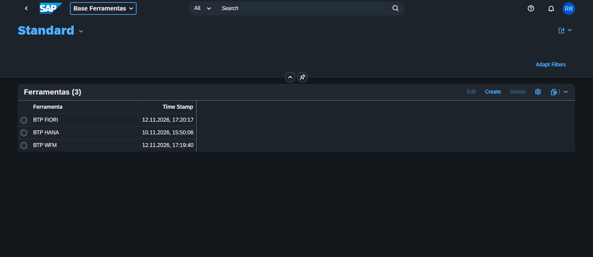
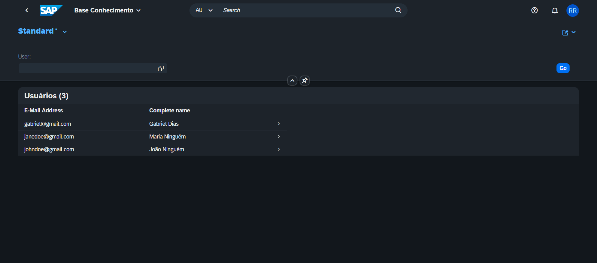
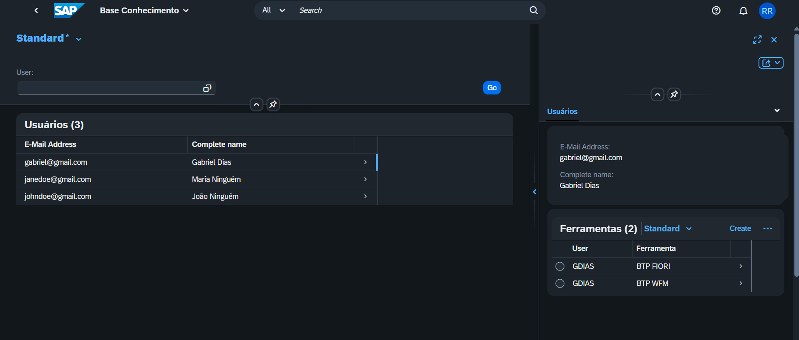

# FIORI-REPORTPAGE

Portfolio project featuring SAP Fiori Elements applications for querying and maintaining a knowledge base related to users and tools. The repository brings together three frontend applications and ABAP objects for persistence, CDS modeling, behavior, and OData service exposure.

> **Documented scope:** description based on the files available in the public repository. The SAP environments and data required to run the solution are not part of this repository.

## Applications

The frontend contains three Fiori Elements applications, generated with the SAP Fiori Application Generator, **List Report Page V2** template, `com.moovi` namespace, and minimum SAPUI5 version `1.114.0`:

| Application | Observable purpose | Configured service |
|---|---|---|
| Knowledge Base (report) | List Report with filters and columns for user, email, name, tool, knowledge, interest, and training availability. | `ZGDSCDS_RPRT_BASE_CONH2_CDS` (OData V2) |
| Tools Base | Tool registration/listing, with create, edit, and delete actions enabled in the ABAP behavior. | `ZGDSSB_C_TOOLS` (OData V2) |
| Knowledge Base (user) | User List Report and Object Page with the user's associated tools. | `ZGDSSB_C_USERS` (OData V2) |

In the user and tool model, the `Knowledge` and `Interest` fields use value helps associated with general levels. The tool entity also has a value help for selecting tools.

## Architecture and flow

1. The Fiori Elements applications load the OData V2 service specified in `manifest.json`.
2. In the backend, the transparent tables `ZGDST_USER`, `ZGDST_TOOLS`, and `ZGDST_USERTOOLV3` store users, tools, and the user-tool relationship.
3. Interface CDS views (`ZGDSCDS_I_*`) model the tables and the composition between user and tools; consumption CDS views (`ZGDSCDS_C_*`) expose projections for the applications.
4. Service definitions expose `ZGDSSB_C_USERS` and `ZGDSSB_C_TOOLS`. The report also points to the published service `ZGDSCDS_RPRT_BASE_CONH2_CDS`.
5. CDS and XML annotations provide UI metadata, such as headers, columns, selection fields, facets, and value helps.

**Note:** the repository does not contain configuration to spin up a local ABAP backend. Integrated execution depends on an SAP system with the objects imported/activated, published services, and authorized access.

## Identified technologies

- SAP ABAP and ABAP CDS (RAP, interface/consumption entities, and behavior definitions).
- SAP Fiori Elements / SAPUI5; OData V2.
- SAP Fiori tools and UI5 Tooling (`@sap/ux-ui5-tooling`, `@ui5/cli`).
- Node.js and npm to run frontend tasks.
- ESLint with SAP Fiori tools rules.

The `package.json` files declare `@ui5/cli` `^4.0.33`, `@sap-ux/eslint-plugin-fiori-tools` `^10.0.0`, and tooling dependencies. The installed versions and the recommended Node version for this setup must be confirmed before reproducing the execution.

## Repository structure

```text
.
├── backend/
│   ├── behavior/       # RAP behavior and projection definitions
│   ├── cds/            # Interface, consumption, value help, and report CDS views
│   ├── classes/        # ABAP implementations of behavior handlers
│   ├── dictionary/     # Documented tables and data element
│   ├── metadata/       # UI CDS annotations
│   └── services/       # Service definitions and binding notes
├── frontend/
│   ├── base.conhecimento.report.gith/
│   ├── base.ferramentas.gith/
│   └── base.usuario.gith/
└── README.md
```

Each frontend application directory contains `package.json`, UI5 configuration files (`ui5*.yaml`), `webapp/manifest.json`, `webapp/annotations/`, `webapp/i18n/`, edit fragment, and Fiori tools generation files. The `localService/` directories appear configured for metadata/mock server; confirm that all required metadata and mock data files are versioned before relying on mock mode.

## Prerequisites

For the frontend, the generated READMEs recommend Node.js LTS and a compatible npm version. For connected execution, the following are also required:

- Access to an SAP ABAP system compatible with the RAP/CDS objects used.
- OData services activated and published in the system.
- Valid URL, authentication, and permissions for the target system.
- Proxy/destination and deployment configurations adjusted to the local environment.

The generated files use `https://seu-host:porta/...` as an illustrative URL in the documentation of some apps. Replace it with a real authorized URL; do not version credentials.

## Frontend setup and execution

Run the commands inside the desired application folder:

```bash
cd frontend/base.conhecimento.report.gith
npm install
npm start
```

Repeat the installation and startup from `frontend/base.ferramentas.gith` or `frontend/base.usuario.gith` for the other applications. Available scripts in each `package.json` include:

| Command | Declared action |
|---|---|
| `npm start` | Runs `fiori run` and opens the application preview in the test FLP. |
| `npm run start-local` | Starts with `ui5-local.yaml`. |
| `npm run start-mock` | Starts with `ui5-mock.yaml` and mock server middleware. |
| `npm run start-noflp` | Opens the application directly via `index.html`. |
| `npm run build` | Generates the UI5 build in `dist`. |
| `npm run lint` | Runs ESLint. |
| `npm run deploy` | Builds and runs `fiori deploy` according to `ui5-deploy.yaml`. |

The `start`, `start-local`, and `start-mock` commands depend on the configurations in their respective YAML files and, in connected mode, on an accessible SAP destination. The deployment configuration contains environment-specific parameters and must be reviewed before use. No execution commands were validated in this documentation.

## ABAP Backend

The backend is delivered as ABAP/CDS source files organized by object type. To use it, import or create the objects in the ABAP system according to the process adopted by the project, activate dependencies in an order compatible with the system, and publish the OData bindings. The repository does not document a complete import, activation, or provisioning procedure.

Services documented in `backend/services/README.md`:

| Binding / service | Indicated use |
|---|---|
| `ZGDSSB_C_USERS` / `ZGDSSD_C_USERS` | Consumed by the Knowledge Base (User) application; exposes user, related tools, and value help entities. |
| `ZGDSSB_C_TOOLS` / `ZGDSSD_C_TOOLS` | Consumed by the Tools Base application; exposes `BaseFerramenta`. |

The `ZGDSCDS_RPRT_BASE_CONH2_CDS` binding is referenced by the report frontend and by the `@OData.publish: true` annotation of the corresponding CDS view; confirm how it is activated/published in the target system.

## Screenshots

### Knowledge base report



### Tools registration



### Knowledge by user






## License

The repository declares the MIT license. See the [`LICENSE`](LICENSE) file for the full terms.
