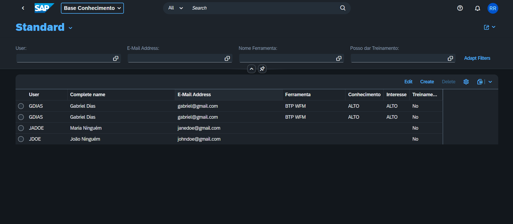
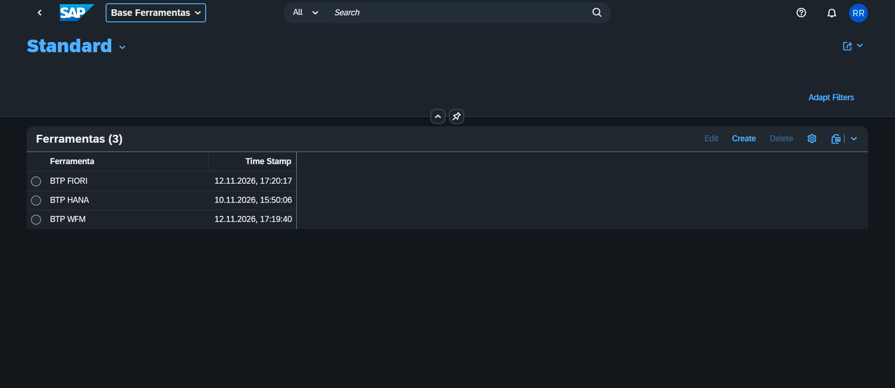
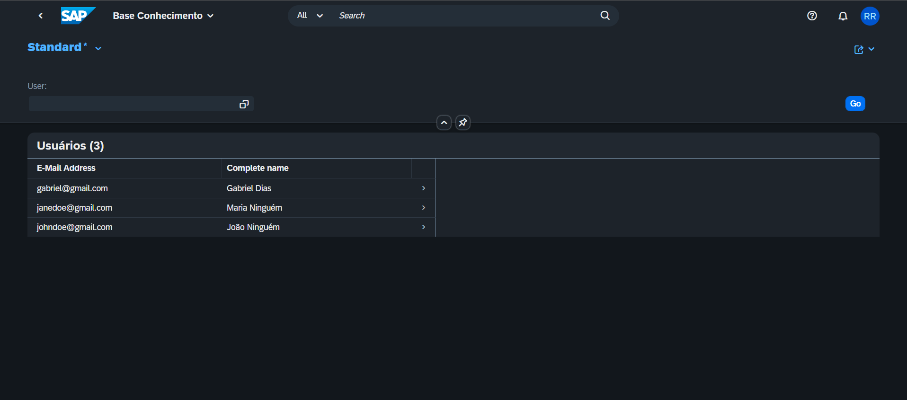
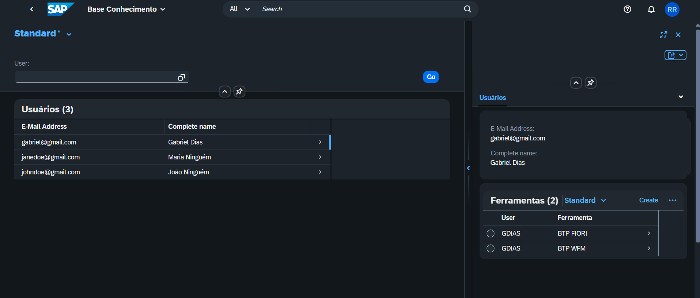
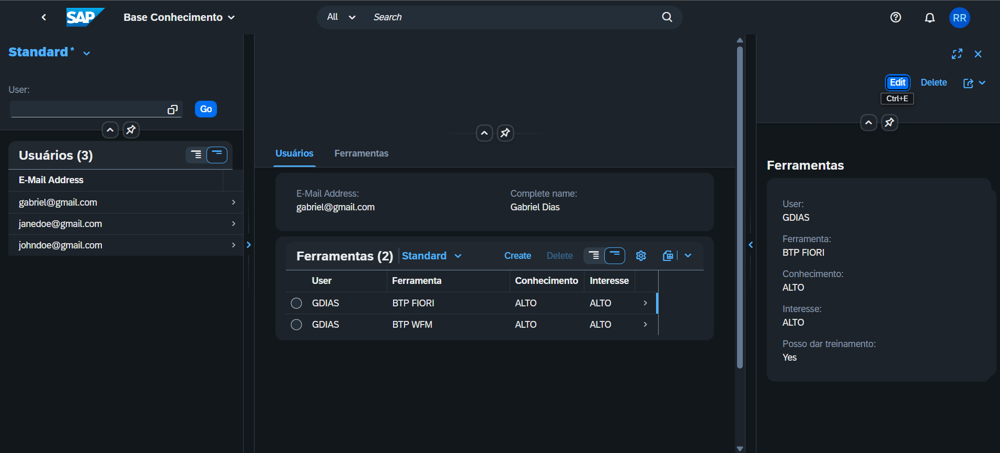

# FIORI-REPORTPAGE

Projeto de portfólio com aplicações SAP Fiori Elements para consulta e manutenção de uma base de conhecimento relacionada a usuários e ferramentas. O repositório reúne três aplicações frontend e objetos ABAP para persistência, modelagem CDS, comportamento e exposição de serviços OData.

> **Escopo documentado:** descrição baseada nos arquivos presentes no repositório público. Os ambientes SAP e os dados necessários para executar a solução não fazem parte deste repositório.

## Aplicações

O frontend contém três aplicações Fiori Elements, geradas com o SAP Fiori Application Generator, template **List Report Page V2**, namespace `com.moovi` e versão mínima SAPUI5 `1.114.0`:

| Aplicação | Finalidade observável | Serviço configurado |
|---|---|---|
| Base Conhecimento (relatório) | List Report com filtros e colunas para usuário, e-mail, nome, ferramenta, conhecimento, interesse e disponibilidade para treinamento. | `ZGDSCDS_RPRT_BASE_CONH2_CDS` (OData V2) |
| Base Ferramentas | Cadastro/listagem de ferramentas, com ações de criação, edição e exclusão habilitadas no comportamento ABAP. | `ZGDSSB_C_TOOLS` (OData V2) |
| Base Conhecimento (usuário) | List Report de usuários e Object Page com a associação de ferramentas do usuário. | `ZGDSSB_C_USERS` (OData V2) |

No modelo de usuário e ferramenta, os campos `Knowledge` e `Interest` usam ajuda de valores associada aos níveis gerais. A entidade de ferramenta também possui ajuda de valores para selecionar ferramentas.

## Arquitetura e fluxo

1. As aplicações Fiori Elements carregam o serviço OData V2 indicado no `manifest.json`.
2. No backend, as tabelas transparentes `ZGDST_USER`, `ZGDST_TOOLS` e `ZGDST_USERTOOLV3` armazenam usuários, ferramentas e a relação usuário-ferramenta.
3. CDS de interface (`ZGDSCDS_I_*`) modelam as tabelas e a composição entre usuário e ferramentas; CDS de consumo (`ZGDSCDS_C_*`) expõem projeções para as aplicações.
4. Definições de serviço expõem `ZGDSSB_C_USERS` e `ZGDSSB_C_TOOLS`. O relatório também aponta para o serviço publicado `ZGDSCDS_RPRT_BASE_CONH2_CDS`.
5. Anotações CDS e XML fornecem metadados de interface, como cabeçalhos, colunas, campos de seleção, facetas e value helps.

**Observação:** o repositório não contém configuração para subir um backend ABAP local. A execução integrada depende de um sistema SAP com os objetos importados/ativados, serviços publicados e acesso autorizado.

## Tecnologias identificadas

- SAP ABAP e ABAP CDS (RAP, entidades de interface/consumo e definições de comportamento).
- SAP Fiori Elements / SAPUI5; OData V2.
- SAP Fiori tools e UI5 Tooling (`@sap/ux-ui5-tooling`, `@ui5/cli`).
- Node.js e npm para executar tarefas do frontend.
- ESLint com regras SAP Fiori tools.

Os `package.json` declaram `@ui5/cli` `^4.0.33`, `@sap-ux/eslint-plugin-fiori-tools` `^10.0.0` e dependências de tooling. As versões instaladas e a versão de Node recomendada para este conjunto devem ser confirmadas antes de reproduzir a execução.

## Estrutura do repositório

```text
.
├── backend/
│   ├── behavior/       # Definições RAP de comportamento e projeção
│   ├── cds/            # CDS de interface, consumo, value helps e relatório
│   ├── classes/        # Implementações ABAP de handlers de comportamento
│   ├── dictionary/     # Tabelas e elemento de dados documentado
│   ├── metadata/       # Anotações CDS de UI
│   └── services/       # Service definitions e notas sobre bindings
├── frontend/
│   ├── base.conhecimento.report.gith/
│   ├── base.ferramentas.gith/
│   └── base.usuario.gith/
└── README.md
```

Cada diretório de aplicação frontend possui `package.json`, arquivos de configuração UI5 (`ui5*.yaml`), `webapp/manifest.json`, `webapp/annotations/`, `webapp/i18n/`, fragmento de edição e arquivos de geração do Fiori tools. Os diretórios `localService/` aparecem configurados para metadados/mock server; confirmar se todos os arquivos de metadata e dados mock necessários estão versionados antes de depender do modo mock.

## Pré-requisitos

Para o frontend, os READMEs gerados recomendam Node.js LTS e npm compatível. Para execução conectada, é necessário também:

- Acesso a um sistema SAP ABAP compatível com os objetos RAP/CDS utilizados.
- Serviços OData ativados e publicados no sistema.
- URL, autenticação e permissões válidas para o sistema de destino.
- Configurações de proxy/destino e publicação ajustadas ao ambiente local.

Os arquivos gerados usam `https://seu-host:porta/...` como URL ilustrativa em documentação de algumas apps. Substitua por uma URL real autorizada; não versionar credenciais.

## Configuração e execução do frontend

Execute os comandos dentro da pasta da aplicação desejada:

```bash
cd frontend/base.conhecimento.report.gith
npm install
npm start
```

Repita a instalação e inicialização a partir de `frontend/base.ferramentas.gith` ou `frontend/base.usuario.gith` para as outras aplicações. Os scripts disponíveis em cada `package.json` incluem:

| Comando | Ação declarada |
|---|---|
| `npm start` | Inicia `fiori run` e abre a prévia da aplicação no FLP de teste. |
| `npm run start-local` | Inicia com `ui5-local.yaml`. |
| `npm run start-mock` | Inicia com `ui5-mock.yaml` e middleware de mock server. |
| `npm run start-noflp` | Abre a aplicação diretamente pelo `index.html`. |
| `npm run build` | Gera o build UI5 em `dist`. |
| `npm run lint` | Executa ESLint. |
| `npm run deploy` | Faz build e executa `fiori deploy` conforme `ui5-deploy.yaml`. |

Os comandos `start`, `start-local` e `start-mock` dependem das configurações presentes nos respectivos YAMLs e, no modo conectado, de um destino SAP acessível. A configuração de implantação contém parâmetros específicos do ambiente e precisa ser revisada antes do uso. Nenhum comando de execução foi validado nesta documentação.

## Backend ABAP

O backend é entregue como arquivos-fonte ABAP/CDS organizados por tipo de objeto. Para utilizá-lo, importe ou crie os objetos no sistema ABAP conforme o processo adotado pelo projeto, ative dependências na ordem compatível com o sistema e publique os bindings OData. O repositório não documenta um procedimento completo de importação, ativação ou provisionamento.

Serviços documentados em `backend/services/README.md`:

| Binding / serviço | Uso indicado |
|---|---|
| `ZGDSSB_C_USERS` / `ZGDSSD_C_USERS` | Consumido pela aplicação Base Conhecimento (Usuário); expõe usuário, ferramentas relacionadas e entidades de value help. |
| `ZGDSSB_C_TOOLS` / `ZGDSSD_C_TOOLS` | Consumido pela aplicação Base Ferramentas; expõe `BaseFerramenta`. |

O binding `ZGDSCDS_RPRT_BASE_CONH2_CDS` é referenciado pelo frontend do relatório e pela anotação `@OData.publish: true` da CDS correspondente; confirmar como ele é ativado/publicado no sistema de destino.

## Capturas de tela

### Relatório da base de conhecimento



### Cadastro de ferramentas



### Conhecimento por usuário







## Licença

O repositório declara a licença MIT. Consulte o arquivo [`LICENSE`](LICENSE) para os termos completos.
